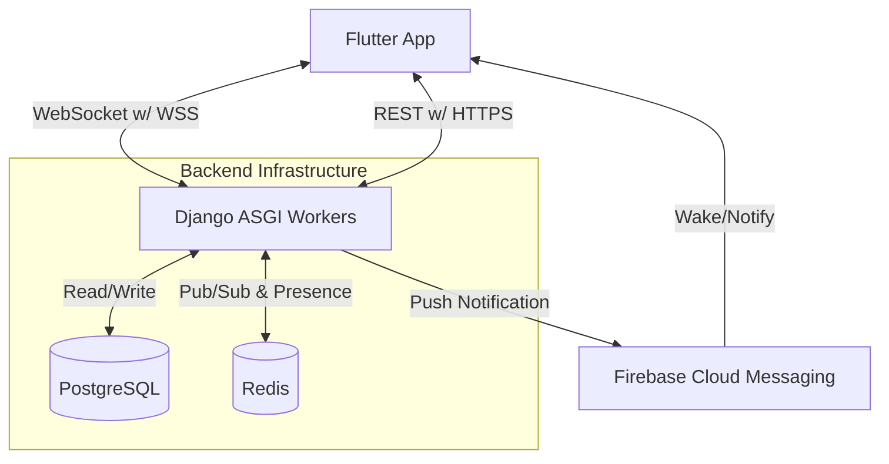
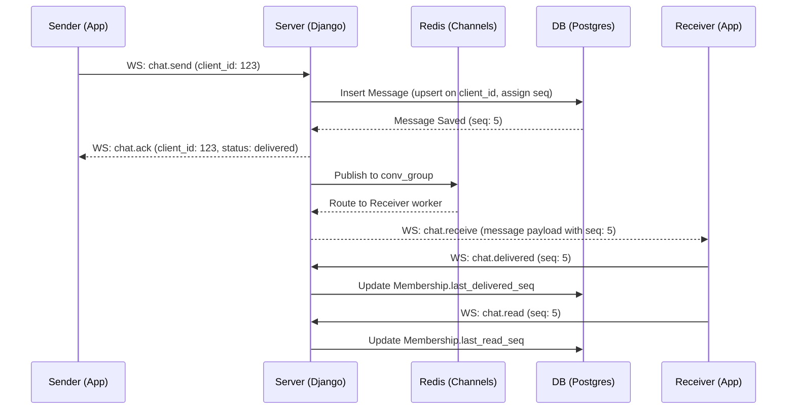

# Architecture Document

## 1. Component Diagram



## 2. Data Model

Designed to be group-ready without future rewrites.

*   **User**: `id` (UUIDv4), `username` (String, Unique), `email` (String, Unique), `display_name` (String), `password_hash`, `avatar_seed`, `created_at`, `updated_at`.
*   **Conversation**: `id` (UUIDv4), `type` (Enum: `dm`, `group`), `name` (String, nullable for DMs, 1-50 chars for groups), `dm_key` (String, nullable for groups, unique format `<sorted_uuid1>:<sorted_uuid2>` for DMs), `next_seq` (Integer, default 1), `created_at`, `updated_at`.
    *   *Check Constraints*: `check_group_has_name` (group requires name), `check_dm_has_dm_key` (dm requires dm_key).
*   **Membership**: `id` (UUIDv4), `user_id` (FK User), `conversation_id` (FK Conversation), `role` (Enum: `admin`, `member`), `joined_at_seq` (Integer, default 0), `last_delivered_seq` (Integer, default 0), `last_read_seq` (Integer, default 0), `created_at`, `updated_at`.
    *   *Indexes*: `(user_id, conversation_id)` unique constraint.
*   **Message**: `id` (UUIDv4), `conversation_id` (FK Conversation), `seq` (Integer), `sender_id` (FK User), `body` (Text), `client_id` (String), `is_system` (Boolean, default False), `system_data` (JSON, nullable), `created_at`.
    *   *Indexes*: `(conversation_id, seq)` unique index for fast, ordered pagination.
    *   *Constraint*: `(sender_id, client_id)` unique to enforce idempotency. Sending a message with an already-used `client_id` returns the existing message without consuming a new `seq`.
    *   *Seq Assignment*: `seq` is assigned safely under concurrent sends by incrementing the `next_seq` counter on the parent `Conversation` within the same database transaction (locking the conversation row via `SELECT ... FOR UPDATE` before inserting the message).
    *   *Payload Invariant*: Every message payload includes `sender_display_name` and `sender_avatar_seed` so ex-members' history displays correctly without runtime membership lookups.

*Note on Read/Delivered State*: Monotonic sequence pointers `last_delivered_seq` and `last_read_seq` per member per conversation avoid per-message tracking tables and maintain strict monotonic ordering.

## 3. WebSocket Protocol

A single, versioned JSON envelope is used over the WebSocket connection. 
*   **Authentication**: Passed in standard HTTP headers during the initial WebSocket handshake (`Authorization: Bearer <JWT>`). The token is validated at connect only. If expired, the server closes the connection with code `4401`, prompting the client to refresh via REST and reconnect.

**Envelope Format:**
```json
{
  "v": 1,
  "type": "<event_type>",
  "client_id": "<uuid_generated_by_client>",
  "payload": { ... }
}
```

**Event Types:**
*   `chat.send` (Client -> Server): Send a new message.
*   `chat.receive` (Server -> Client): New message delivered to recipient.
*   `chat.ack` (Server -> Client): Acknowledges `chat.send`. Payload contains `seq` and `status: "sent"`.
*   `chat.delivered` (Client -> Server): Updates the `last_delivered_seq` pointer.
*   `chat.read` (Client -> Server): Updates the `last_read_seq` pointer.
*   `chat.status` (Server -> Client): Broadcasts pointer updates to members.
*   `chat.typing` (Bi-directional): Ephemeral typing status broadcast to all other members in the conversation. Payload: `{ "conversation_id": "...", "user_id": "...", "username": "...", "display_name": "...", "is_typing": true }`.
*   `membership.added` (Server -> Client): Broadcast when members are added to a group.
*   `membership.removed` (Server -> Client): Broadcast when a member leaves or is removed from a group.
*   `membership.updated` (Server -> Client): Broadcast when a member's role is updated (promoted/demoted).
*   `conversation.updated` (Server -> Client): Broadcast when a conversation's name is updated.
*   `error` (Server -> Client): Payload contains error `code` and `message`.

## 4. Message Lifecycle



## 5. Reconnect and Sync Strategy

To simplify the WebSocket state machine, missed message synchronization is handled via a REST endpoint.
1.  **Disconnect**: The client loses connection or goes to the background.
2.  **Reconnect**: Upon waking up, the client establishes a new WebSocket connection.
3.  **Sync**: The client queries local storage for its most recent `seq` per conversation. It then calls the REST API: `POST /api/messages/sync/` sending a payload mapping `{ conversation_id: last_seen_seq }`.
4.  **Catch up**: The server returns all messages across requested conversations having a `seq` greater than the client's `last_seen_seq`. The client processes these and updates local storage.

## 6. Redis Usage

Redis is treated as strictly ephemeral. It is never used as primary storage.
*   **Channel Layer**: Used by Django Channels for routing messages between ASGI workers. Channel names: `conv_<conversation_id>`.
*   **Presence Tracking**: 
    *   Key: `presence:user:<user_id>` (String).
    *   Value: `1`
    *   TTL: ~60-90 seconds.
    *   A foregrounded client sends a heartbeat ping every 30s to refresh the TTL. The server also enforces an immediate offline status upon a TCP WebSocket disconnect. Heartbeats stop when the app is backgrounded.

## 7. Push Decision Logic (FCM)

To avoid sending unnecessary notifications while the user is actively chatting:
1.  When a message is successfully saved to the database, the server checks the Redis presence key for all other conversation members.
2.  If `presence:user:<user_id>` exists, the server relies on the WebSocket `chat.receive` event and **skips** FCM.
3.  If the presence key is missing (user is offline or backgrounded), the server fires an FCM push notification.

## 8. Free-Tier Limits & Cold-Start Behavior

The architecture expects and gracefully handles aggressive free-tier limits:
*   **Cold Starts**: The free hosting provider (e.g., Render) spins down the application after 15 minutes of inactivity. The first API or WS request will take 10-30 seconds to wake the server. 
    *   *Client Recovery*: The Flutter app implements a robust exponential backoff retry loop for HTTP requests and WebSocket connections, displaying a non-blocking "Connecting..." indicator.
*   **Redis Drops**: Free Redis tiers may drop idle connections. Django Channels will automatically attempt to reconnect to Redis. If the channel layer fails, the ASGI worker will return an error to the client, triggering the client's retry logic.

## 9. Deployment Topology & Upgrades

Moving to production requires **no code changes**, only environment variable updates.

*   **Current Free-Tier Topology**: 1 ASGI Web Service (Render), 1 Shared Free Postgres DB, 1 Shared Free Redis. All communicate over the public internet via TLS.
*   **Future Paid Topology**: 
    *   Multiple ASGI web workers scaled horizontally behind a load balancer.
    *   Managed PostgreSQL (e.g., AWS RDS, Neon Pro) with daily automated backups and read replicas.
    *   Managed Redis (e.g., Elasticache) within a private VPC.
    *   *Change required*: Update `DATABASE_URL` and `REDIS_URL` in the environment variables.
